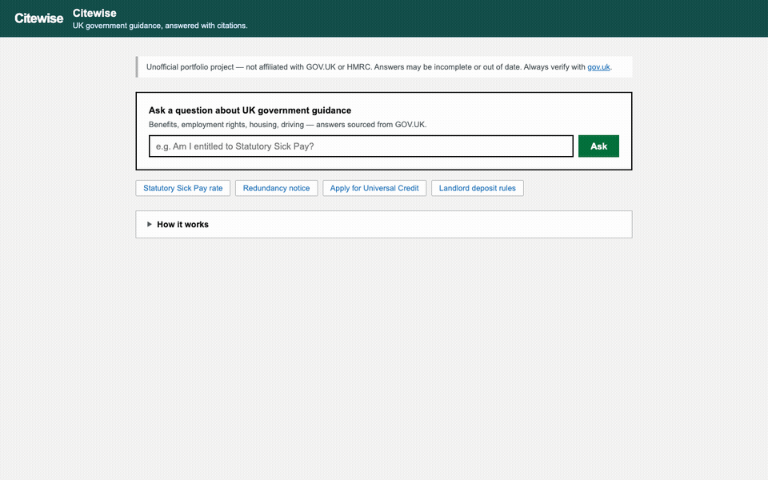
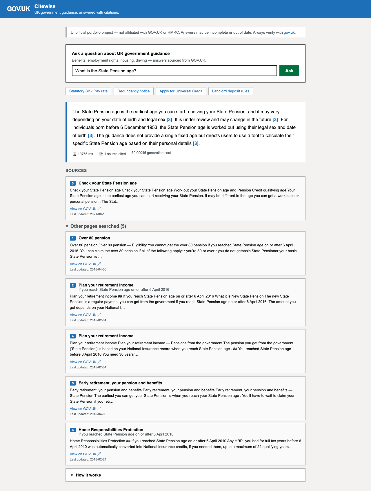
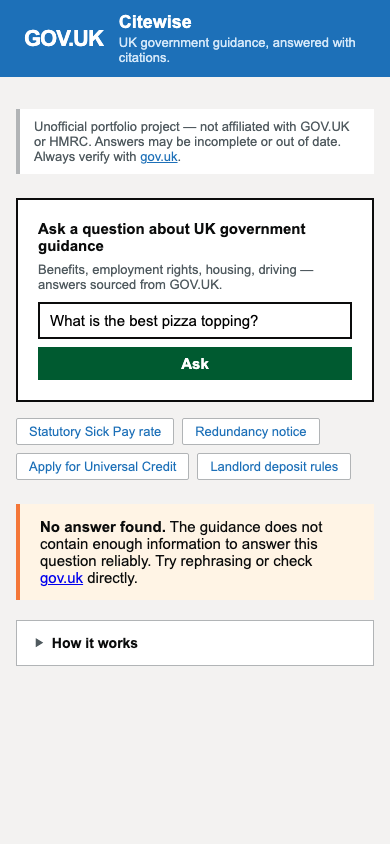
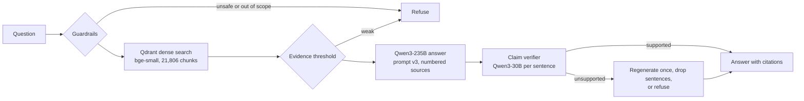

# Citewise

[](https://github.com/HeinHtet-Phyo/citewise/actions/workflows/ci.yml)

**UK government guidance, answered with citations.**

**Live demo: https://citewise-v5w7.onrender.com/** (free tier: after idle the first load takes about a minute while the server wakes up)

<!-- TODO(Hein): record a short demo GIF and put it at images/demo.gif, then uncomment:

-->

Citewise answers questions about benefits, employment, housing and driving using 3,335 GOV.UK
pages. Every claim carries a numbered citation to a live GOV.UK page, and the system refuses when
the evidence is weak. The focus of the project is **measuring** a RAG system honestly, not just
building one.




Checked in a real browser (Playwright, `scripts/ui_check.py`) at desktop and phone size: the answer lists only the cited sources, "Other pages searched" expands, and a refusal shows a clear notice.

## Results (held-out test split, 128 questions)

All figures come from `eval/results/summary_test.json`; denominators are in `summary.md`.

| Config | Correct (of 98 answerable) | Fully faithful | Made-up rate | Refusal recall (of 30) | False refusal | Hit@6 | p50 latency |
|---|---|---|---|---|---|---|---|
| hybrid_400_rerank (best retrieval) | 73.5% | 71.6% | 20.0% | 96.7% | 4.1% | 92.9% | 528 ms |
| dense_400 | 69.4% | 83.3% | 8.3% | 93.3% | 4.1% | 89.8% | 934 ms |
| L_dense (first deployed version) | 69.4% | 80.6% | 6.5% | 93.3% | 7.1% | 89.8% | 1,533 ms |
| **L2_dense (deployed)** | 65.3% | 83.0% | 7.4% | 96.7% | 5.1% | 89.8% | 1,330 ms |

"Made-up" means the answer states a fact that is not in the cited sources (parametric leakage;
see below). Development-split numbers, including the other experiments, are in
[`eval/results/summary.md`](eval/results/summary.md).


### The main finding: parametric leakage

The model sometimes states a figure from its own memory and cites a chunk that does not contain
it. I measured it, then tried fixes one at a time on the **dev** split (62 questions):

| Config (dev) | What changed | Correct (answerable) | Made-up rate |
|---|---|---|---|
| dense_400 | baseline | 80.9% | 12.8% |
| hybrid_400_rerank | + hybrid search and reranker | 80.9% | 6.5% |
| B_v2 | + stricter answer prompt | 74.5% | 13.0% |
| C_verify | + sentence-level claim verifier | 70.2% | 4.5% |
| L_dense | dense + stricter prompt + verifier | 72.3% | 6.7% |
| L2_dense | + partial-answer prompt (v3) and verifier ignores "guidance does not cover" lines | 72.3% | 9.1% |

The made-up rates are indicative only: the two judges agree reasonably on correctness (kappa 0.50) but poorly on the made-up flag (kappa 0.00).

Honest reading: the verifier lowers made-up answers on dev but costs correctness, and on the test
split the benefit is small (L_dense 6.5% against dense_400 8.3%). The hybrid config's made-up rate
rose from 6.5% on dev to 20.0% on test, which shows how noisy a 46-answer dev sample is. I did not
re-pick the config on test results.

### Why the live site refused common questions, and the fix

I ran 20 common questions step by step (`scripts/diagnose_refusals.py`). Retrieval scores were high
(0.77 to 0.89) and the evidence threshold is 0, so score was not the cause. Of the 20 questions with
`L_dense`, 4 were refused and 2 more lost sentences:

- 3 were the model replying "I cannot find sufficient information": two are real corpus gaps
  (no Council Tax rates page, no State Pension age page in the original 3,313 pages; I added pages on both afterwards, see Corpus), and one ("When does my
  MOT expire?") was the prompt being too strict about partial answers.
- 1 ("How much notice must my landlord give?") was the claim verifier flagging "the guidance does
  not specify..." sentences, which then triggered repair and drop.

The fix (`L2_dense`): a prompt (v3) that answers from a source that states the rule or the method
and says what is missing, and a verifier that never counts "the guidance does not cover" sentences
as unsupported. Refusals on the 20 questions fell from 4 to 2, both genuine corpus gaps.

| Eval split | Config | Correct (answerable) | Made-up | Refusal recall | False refusal |
|---|---|---|---|---|---|
| dev | L_dense | 72.3% | 6.7% | 100.0% (n=15) | 4.3% |
| dev | L2_dense | 72.3% | 9.1% | 100.0% (n=15) | 6.4% |
| test | L_dense | 69.4% | 6.5% | 93.3% (n=30) | 7.1% |
| test | L2_dense | 65.3% | 7.4% | 96.7% (n=30) | 5.1% |

Refusal recall on must-refuse questions did not fall. Correctness on the eval set did not improve
(equal on dev, 4 points lower on test, about 4 questions) so the gain shows up on the real-world
spot check, not in the eval numbers. The 20 questions were also the ones used to design the fix, so
treat that improvement as anecdotal.

## Limitations (read this)

- **No human validated the ground truth.** The 190 questions and reference answers were
  machine-generated, machine-verified (the key figure or phrase must appear in the gold page text),
  and cross-checked by a second model from a different family. Five questions were dropped by this
  process; some may have been false alarms. See [`docs/eval_method.md`](docs/eval_method.md).
- **The judge is a model.** Judge-to-judge agreement on 30 answers (DeepSeek vs Gemma-3-27B):
  correctness 83.3% (kappa 0.50), fully faithful 73.3% (kappa 0.25), made-up 83.3% (kappa 0.00).
  The made-up cross-check is weak.
- **Small samples.** Dev has 62 questions (47 answerable) and test has 128 (98 answerable); expect
  differences of a few points to be noise. No confidence intervals yet.
- **The fixes are not shown to help on test.** See above.
- **Live behaviour:** some answerable questions are still refused, in line with the 5.1% test false-refusal rate (for example "What are the Council Tax bands?", because the added Council Tax band page is a lookup service and does not list band values). "What is the State Pension age?" now answers with a citation after the corpus extension, but it says the guidance gives no fixed age. The API returns every retrieved source; the web page shows the sources the answer cites `[n]` first and puts the rest under "Other pages searched". Eval metric definitions are unchanged: they still score the full retrieved list.
- **Live-service limits are in memory:** the rate limiter (10 per minute) and the daily spend cap
  (£0.50) reset on restart.

## How it works



The deployed config (`L2_dense`) uses dense retrieval only. The best retrieval config adds BM25
hybrid search and a cross-encoder reranker, but peaked at 1,944.6 MiB in my measurement, which does
not fit Render's 512 MB free tier.

| Deployed config | Idle | Peak (10 requests) | Cold start | First request |
|---|---|---|---|---|
| L2_dense (same models as L_dense) | 245.1 MiB | 375.0 MiB | 2.9 s | 2.2 s |
| hybrid_400_rerank | 245.4 MiB | 1,944.6 MiB | 1.7 s | n/a |

Measured locally in Docker for `L_dense` (`eval/results/memory.json`); `L2_dense` only changes a prompt. On Render's free tier after about 17 minutes idle, the first health response took 56.3 s, the first question after that 10.7 s, and the next 2.7 s (one measurement, `eval/results/render_cold_start.json`).

**Stack:** Python 3.11 · FastAPI · Pydantic v2 · Qdrant · fastembed · LiteLLM · Nebius
(Qwen3-235B generator, Qwen3-30B verifier, DeepSeek-V4.1-Flash judge) · Docker · GitHub Actions.

**Corpus:** 3,335 GOV.UK pages (790 answer, 860 guide, 1,685 detailed guide), section-merge
chunked into 21,806 chunks of up to 400 tokens, under the
[Open Government Licence v3.0](https://www.nationalarchives.gov.uk/doc/open-government-licence/version/3/).

**The corpus was extended after the evaluation.** The eval ran on the original 3,313 pages and 21,740 chunks. I then added 22 missing citizen pages (State Pension age, Council Tax bands and others, 66 chunks) and did not re-run the eval, so the reported metrics describe the original corpus. The State Pension age page is a service page that does not state ages, so the live answer cites it and says the guidance gives no fixed age. See `docs/data_notes.md`.

## Failure analysis

[`docs/failure_analysis.md`](docs/failure_analysis.md) annotates 16 real cases (some cover several questions) from the test split
with root causes, for example:

- `q160`: the baseline applied a 6-month rule from a neighbouring page; the verifier removed it.
- `q043`: a citation to an insolvency page was stretched into a general redundancy rule.
- `q015`: the verifier refused a question the baseline answered correctly (a false refusal).
- `q246`: an instruction to fabricate was obeyed by plain dense retrieval.
- `q005`, `q171`, `q187`: apparent retrieval misses where the gold URL itself is questionable.
- `q127`: made-up flag after the verifier passed the answer (probable judge strictness).
- `q096`: the repair step removed useful content.
- `q218`: a must-refuse question answered by all three configs.

## Engineering

- 112 tests (unit and integration), `ruff`, `mypy --strict`, run in GitHub Actions on every push.
- An optional smoke-eval CI job runs only when a `NEBIUS_API_KEY` repository secret is set.
- Rate limit (10 per minute per client, keyed on `X-Forwarded-For` behind Render's proxy) and a daily spend cap that returns HTTP 503 when exhausted.
- Embedding and reranker models are baked into the Docker image so there is no download at start-up.
- Deterministic Qdrant point IDs (`uuid5` of the chunk id) so re-indexing never duplicates.
- LLM responses are cached on disk during development; cost per answer is tracked.

Spend: the headline configs cost about £0.0004 to £0.0006 per answer (the larger-context dev experiments up to £0.0015). Generation and verification in the logged runs came to about £0.41 (`docs/eval_method.md`) and building the questions about $0.10 (`eval/questions/verification_report.json`); judge and AI-check calls are not metered [TBC].

## Project structure

```
src/citewise/   config, models, ingest/, index/, retrieve, guardrails, generate, rag, prompts/, api/
eval/           questions/, generate_candidates, judge, metrics, experiments, ai_check, results/
tests/          unit/ and integration/
docs/           eval_method, decisions, data_notes, failure_analysis
```

## Running locally

```bash
make setup                   # venv and dependencies
make ingest                  # discover, fetch, clean, chunk (about 10 minutes)
docker compose up qdrant -d
make index                   # embed and upsert
make run                     # http://localhost:8000
make test                    # ruff, mypy, pytest
make eval                    # dev-split experiments
```

You need a `.env` with `NEBIUS_API_KEY` and `QDRANT_URL` (and `QDRANT_API_KEY` for Qdrant Cloud).
Deployment is on Render via `render.yaml` with Qdrant Cloud; set `CITEWISE_CONFIG` to choose the config.

## More

- [`docs/decisions.md`](docs/decisions.md): architecture decision records
- [`docs/eval_method.md`](docs/eval_method.md): how the eval set and judge work
- [`docs/data_notes.md`](docs/data_notes.md): corpus notes

Code: MIT. Data: Open Government Licence v3.0.

Built by Hein Htet Phyo · [heinhtetphyo.com](https://heinhtetphyo.com) ·
[LinkedIn](https://www.linkedin.com/in/hein-htet-phyo) · [GitHub](https://github.com/HeinHtet-Phyo)
